# Nepal Case Management — वित्तीय अपराध मुद्दा व्यवस्थापन

A case management system for financial-crime investigation in Nepal. Banks and other reporting institutions send suspicious transaction reports (STRs) and transaction files. Detection rules flag structuring, rapid movement of funds, dormant accounts and large payments to politically exposed persons. Analysts at the Financial Intelligence Unit triage the alerts, investigate cases and recommend dissemination. A second supervisor approves before a case goes to an investigating agency such as the Department of Money Laundering Investigation.

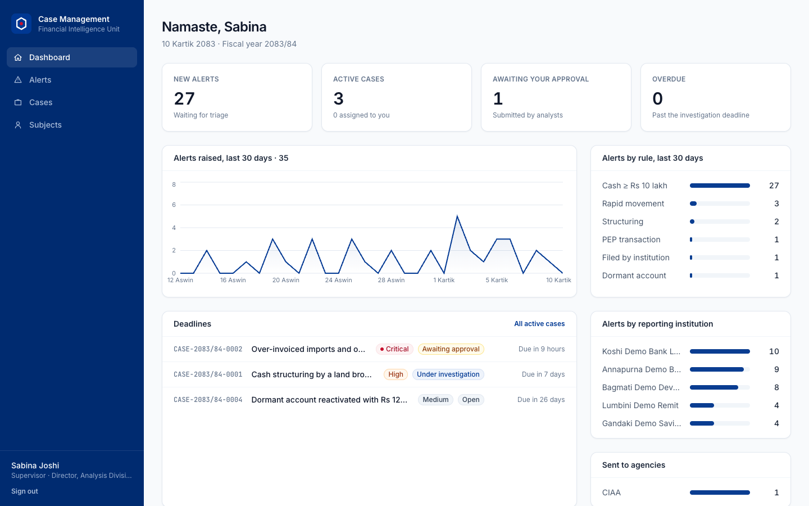

## Features

**Reporting institutions** (bank and cooperative compliance officers)
- File an STR for an individual or a company: Nepali and English names, citizenship number or PAN, district, and PEP status
- Upload up to 1,000 transactions as CSV. Each row is checked before upload, and the result lists any alerts raised
- See the reports and alerts for their own institution only. Triage notes and case links are never shown to them

**Analysts**
- An alert queue sorted by risk score, with filters by status, type and institution
- Triage each alert: open a new case, add it to an existing case, or mark it a false positive with a reason
- A case file with the stage, alerts, transactions, notes, tasks and a full activity log
- Subject profiles with money-in, money-out and cash totals, and a money-flow network. A counterparty who is another known subject is highlighted and links to that subject's profile
- Submit findings with a recommendation: send to an agency, or close

**Supervisors**
- Assign and reassign cases, change priority, close duplicates early
- Approve or return submitted cases. **Four-eyes rule:** the officer who submitted a case can never approve it. The API enforces this, not just the UI

**Administrators**
- Add unit staff or institution officers, change roles, deactivate accounts, issue one-time temporary passwords

**Built for Nepal**
- Bikram Sambat dates (`10 Kartik 2083`) in the Asia/Kathmandu time zone, and Nepal's fiscal year starting 1 Shrawan
- References per fiscal year: `STR-2083/84-0001`, `TTR-…`, `ALT-…`, `CASE-…`
- Amounts in lakh and crore (`Rs 12,34,567`, `Rs 37.2 lakh`)
- Rs 10 lakh cash threshold reporting, all 77 districts, and the receiving agencies: DMLI, Nepal Police CIB, DRI, IRD, CIAA and NRB
- Investigation deadlines by priority: critical 7 days, high 15, medium 30, low 60

| | |
|---|---|
| 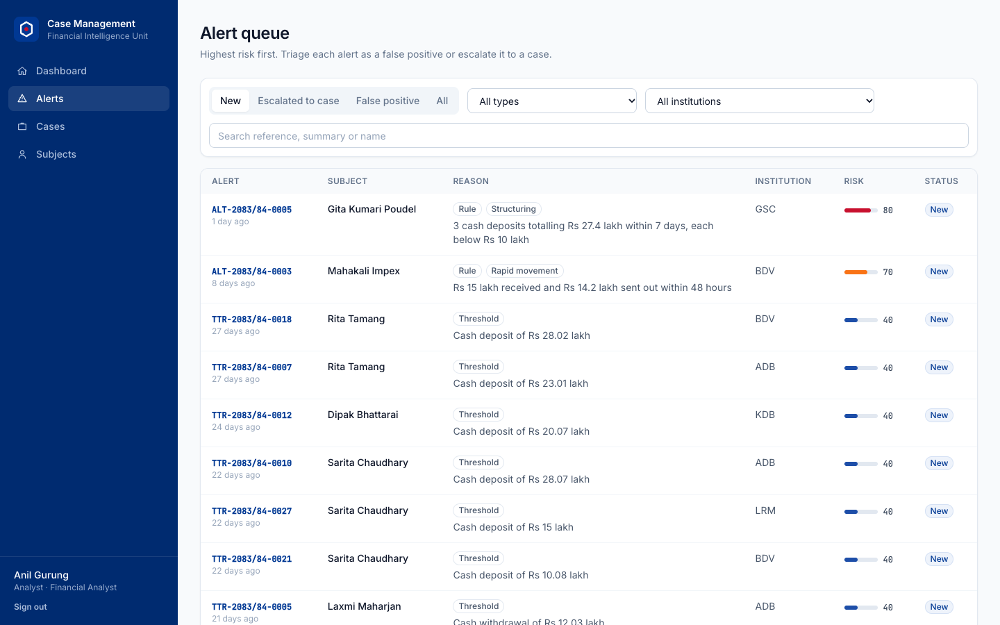 | 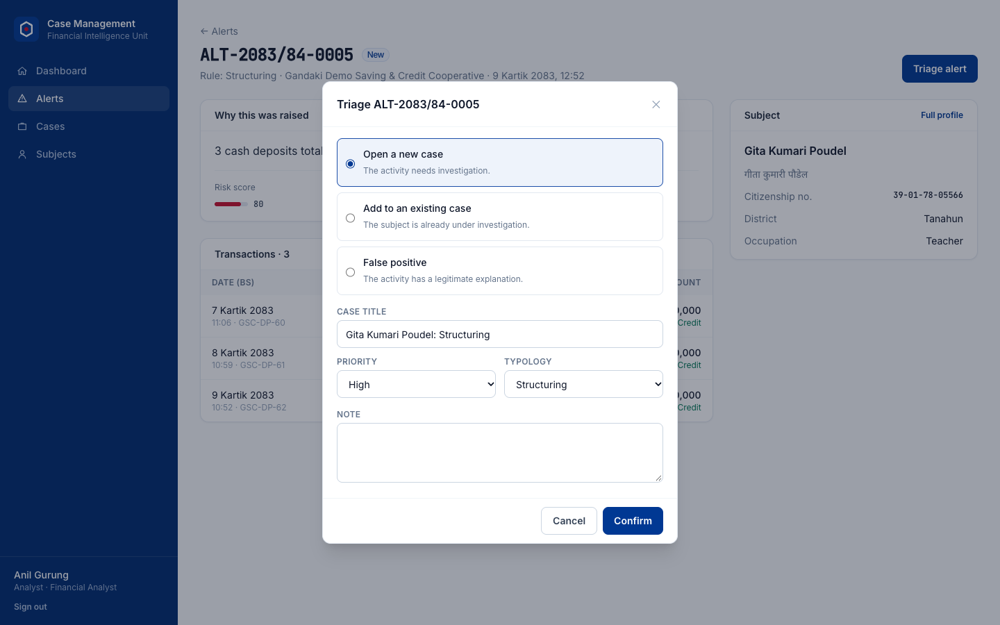 |
| 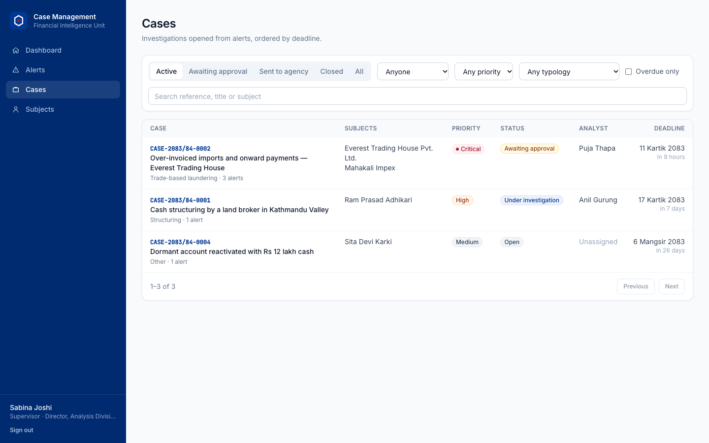 | 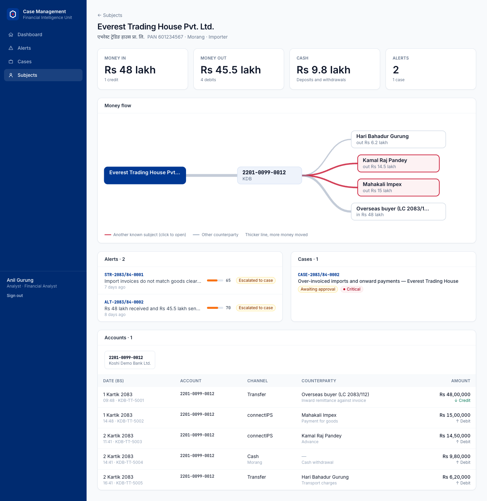 |
| 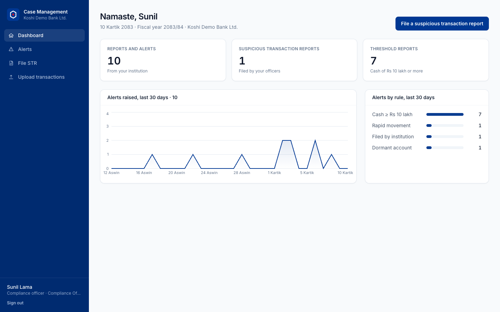 | 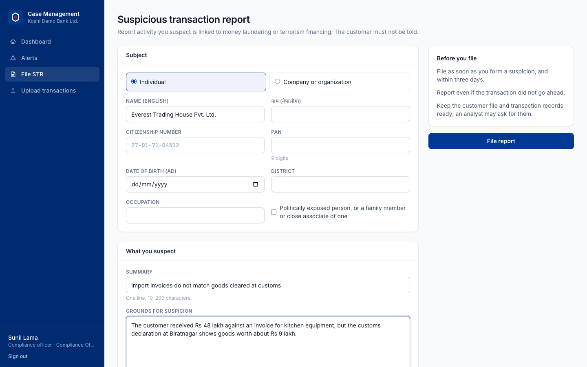 |
| 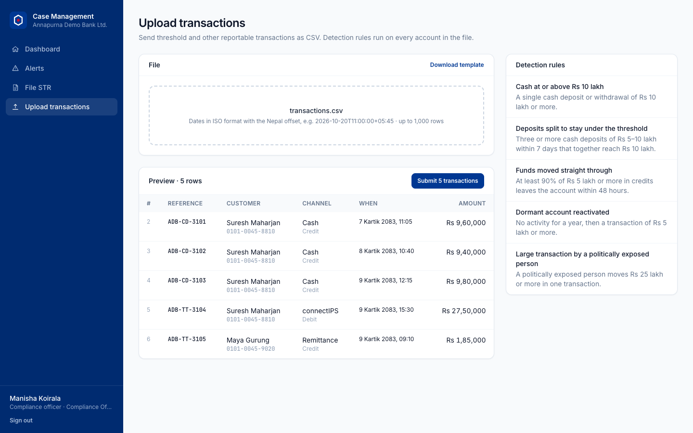 | 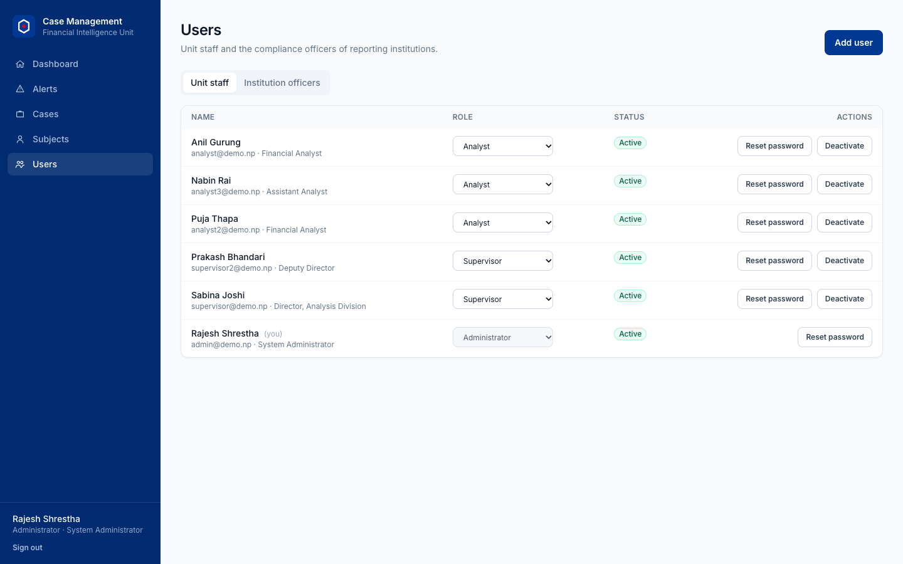 |

<p>
  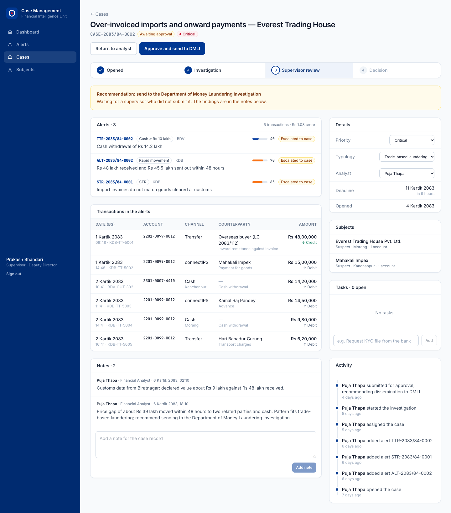
  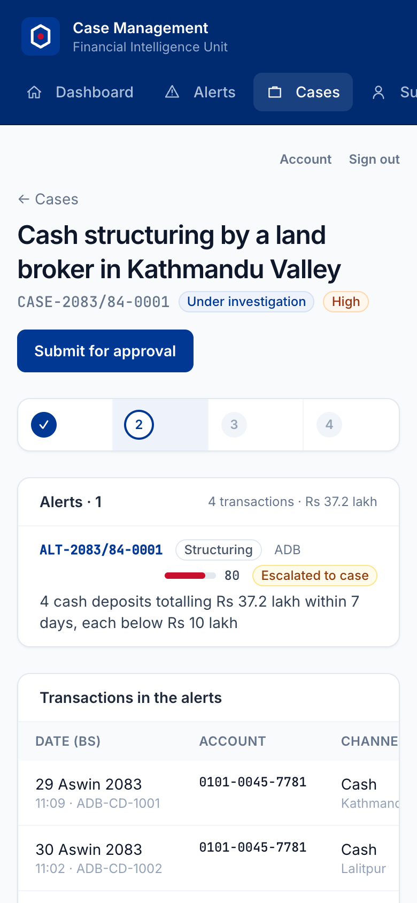
</p>

## How a case moves

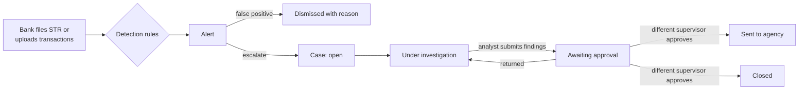

## Detection rules

The rules run on every account touched by an upload, over a 30-day window. A rule does not raise a second alert for the same transactions.

| Rule | Fires when | Score |
|---|---|---|
| Cash threshold | One cash deposit or withdrawal of Rs 10 lakh or more | 40 |
| Structuring | 3 or more cash deposits of Rs 5–10 lakh within 7 days, totalling at least Rs 10 lakh | 80 |
| Rapid movement | At least 90% of Rs 5 lakh or more in credits leaves the account within 48 hours | 70 |
| Dormant account | No activity for a year, then a transaction of Rs 5 lakh or more | 60 |
| PEP transaction | A politically exposed person moves Rs 25 lakh or more at once | 75 |
| STR | Filed by a reporting institution | 65 |

## Architecture

```
frontend/  React 18 · TypeScript · Vite · Tailwind · TanStack Query · Recharts
   │  REST + JWT
backend/   NestJS 11 · TypeScript · Prisma · PostgreSQL
   ├─ auth        email + password, JWT, role guard that re-reads the user on every request
   ├─ reports     STR filing, transaction upload, detection rules
   ├─ alerts      queue, triage, institution scoping
   ├─ cases       workflow, notes, tasks, assignment, audit log
   ├─ subjects    search, profile, money-flow network
   ├─ dashboard   alert trend, rule breakdown, deadlines
   └─ admin       users, institutions
```

## Running locally

Requirements: Node.js 20 and PostgreSQL 13 or newer.

```bash
# 1. Backend
cd backend
cp .env.example .env       # set DATABASE_URL and JWT_SECRET
npm install
npm run db:migrate
npm run db:seed            # demo institutions, staff, 46 transactions, 35 alerts, 5 cases
npm run dev                # http://localhost:4000/api

# 2. Frontend
cd ../frontend
cp .env.example .env       # VITE_API_URL=http://localhost:4000/api
npm install
npm run dev                # http://localhost:5173
```

All demo institutions and people are fictional. Demo logins use the password `Demo@2083`:

| Role | Login |
|---|---|
| Analysts | `analyst@`, `analyst2@`, `analyst3@demo.np` |
| Supervisors | `supervisor@`, `supervisor2@demo.np` |
| Administrator | `admin@demo.np` |
| Bank compliance officers | `adb@`, `kdb@`, `bdv@`, `gsc@`, `lrm@demo.np` |

## Tests

```bash
cd backend
npm test        # 27 passing: detection rules, the case workflow, and end-to-end API tests
cd ../frontend
npm run build   # type-check and production build
```

The end-to-end tests run against `TEST_DATABASE_URL` and refuse any database whose name does not contain `test`.

## Acknowledgements

Inspired by the [Tazama case management system](https://github.com/tazama-lf/case-management-system).
